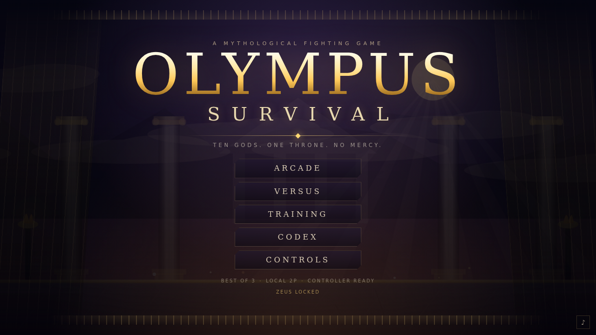
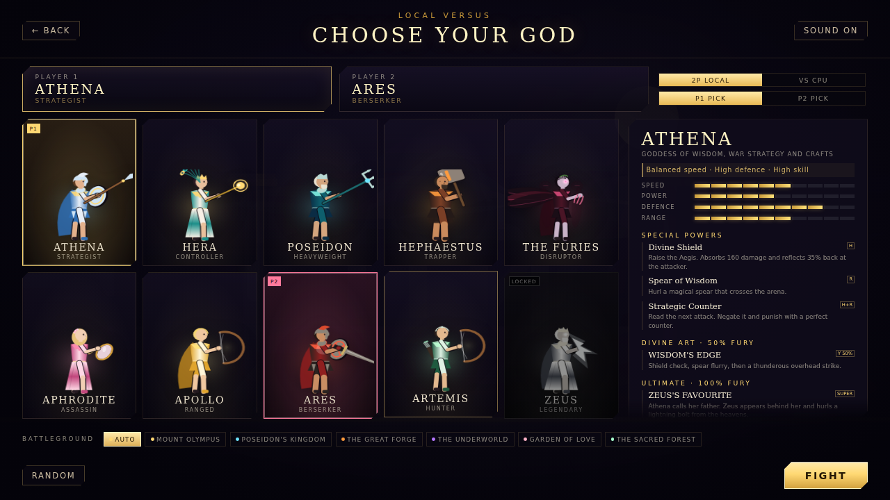
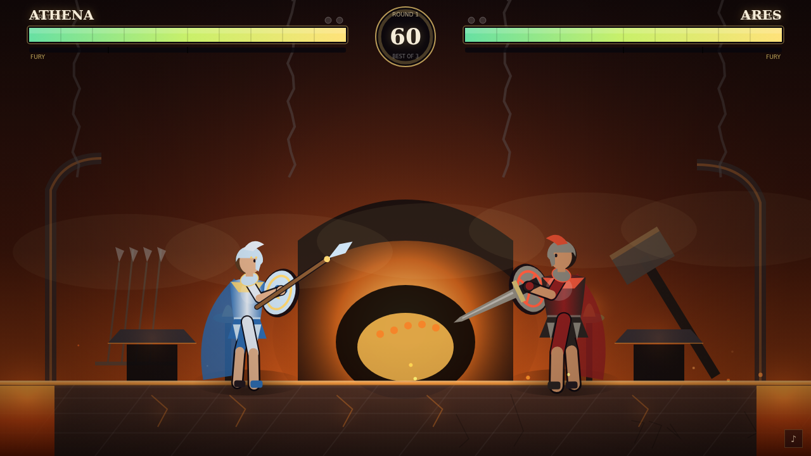
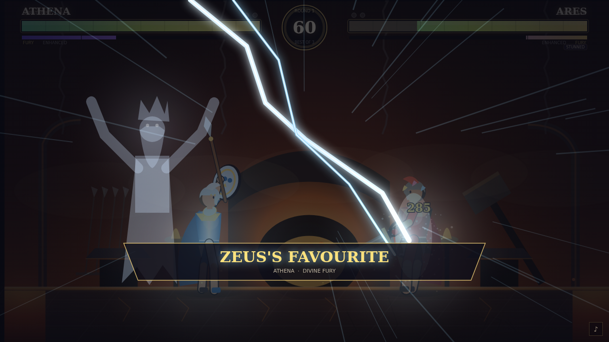
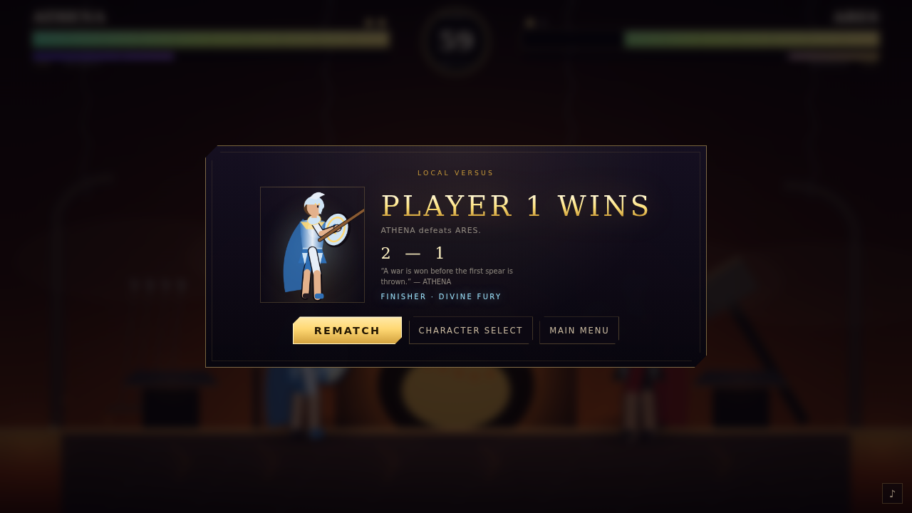

# OLYMPUS: SURVIVAL

A complete, playable 2D mythological fighting game built from the *Olympus: Survival* design document.

Ten gods. Six arenas. Three rounds. No mercy.

**▶ Play online: <https://shapleya.github.io/olympus-survival/>**

Everything — characters, animation, arenas, particles, UI and sound — is generated in code. There are no external image, font or audio assets, no network calls, and no build step.











---

## Quick start

Play it in any modern browser at **<https://shapleya.github.io/olympus-survival/>** — desktop or mobile.

To run it locally, open **`index.html`** in a browser (Chrome, Edge or Firefox).

For the cleanest experience (and to avoid any `file://` storage quirks), serve the folder:

```bash
cd greek_gods_game
python3 -m http.server 8000
# then open http://localhost:8000
```

The game is designed for a 1280×720 stage and scales to any window. It supports one keyboard for local 2P and standard gamepads.

---

## Modes

| Mode | Description |
| --- | --- |
| **Arcade** | Pick a god and climb a six-fight ladder: five gods, then Zeus himself. Win the ladder to unlock Zeus. |
| **Versus** | Local 2-player, or 1P vs CPU with Easy / Normal / Hard AI. |
| **Training** | A passive dummy, regenerating health and fury, and a stage for learning every move. |
| **Codex** | Full roster reference: specials, ultimates, passives and fighting styles. |
| **Controls** | View and remap every key for both players. |

Rounds are best of three with a 60-second timer. The player with more health wins a time-over.

---

## Controls

### Default keyboard layout

| Action | Player 1 | Player 2 |
| --- | --- | --- |
| Move left | `←` | `A` |
| Move right | `→` | `D` |
| Jump | `↑` | `W` |
| Crouch | `↓` | `S` |
| Punch | `F` | `J` |
| Kick | `G` | `K` |
| Special 1 | `H` | `L` |
| Special 2 | `R` | `U` |
| Block | `T` | `I` |
| Superpower | `Y` | `O` |

`Esc` pauses. `M` toggles sound. Every binding can be changed from the **Controls** screen; bindings and progress are stored in `localStorage`.

### Command normals

| Input | Attack |
| --- | --- |
| Forward + Punch / Kick | Heavy forward attack |
| Back + Punch / Kick | Back attack |
| Down + Punch | Low punch |
| Down + Kick | Sweep (knocks down) |
| Punch / Kick in the air | Jumping attacks |
| Double-tap ← or → | Dash |

### The third special

Each god has **three** special powers, but only two special buttons. Press **Special 1 + Special 2 together** to use the third — the strategic counter, royal barrier, madness, or another signature technique.

### Divine Fury meter

Fury fills from dealing damage, taking damage and blocking.

| Fury | Super button (`Y` / `O`) |
| --- | --- |
| **25%** | Amplifies Special 1 (extra damage, size and duration) |
| **50%** | Unleashes the character's **Divine Art** combo |
| **100%** | Triggers the **ultimate** cinematic super |

### Gamepad

Standard mapping: **A** punch, **B** kick, **X** special 1, **Y** special 2, **LB/RB/LT** block, **RT** super, **Start** pause. The left stick and D-pad both move.

> **Keyboard ghosting:** cheap keyboards can drop simultaneous key presses. If inputs disappear during local 2P, remap the buttons to keys on opposite sides of the keyboard or use controllers. The remapping screen is there for exactly this reason.

---

## Roster

| God | Style | Passive | Ultimate |
| --- | --- | --- | --- |
| **Athena** | Strategist — counters and defence | Divine Intelligence | Zeus's Favourite |
| **Hera** | Controller — confusion and mind control | Queen of Olympus | Divine Possession |
| **Poseidon** | Heavyweight — water and area damage | Lord of the Ocean | Trident Tsunami Throw |
| **Hephaestus** | Trapper — fire and armour | Master Blacksmith | Wrath of the Forge |
| **The Furies** | Disruptor — madness and psychological attacks | Vengeance | Eternal Punishment |
| **Aphrodite** | Assassin — charm and combos | Irresistible Beauty | Love Hurts |
| **Apollo** | Ranged — light and healing | Solar Regeneration | Wrath of the Sun |
| **Ares** | Berserker — strength and durability | Blood Rage | God of War |
| **Artemis** | Hunter — arrows and animal summons | Predator Instinct | Hunt of the Moon |
| **Zeus** | Legendary — lightning and raw power | King of Olympus | Wrath of Olympus |

Every character has a full basic moveset (punch, kick, heavy forward, back attack, low attack, sweep and two aerial attacks), three specials, a Divine Art combo, an ultimate and a passive. The in-game **Codex** lists them all.

### Unlocking Zeus

Defeat the full Arcade ladder to unlock the King of the Gods in every mode, including Versus. The unlock is saved locally.

For development/testing there is a shortcut: on the character-select screen press **Shift + Z**. (The ladder is the intended route.)

---

## Arenas

| Arena | Home of |
| --- | --- |
| **Mount Olympus** | Athena, Hera, Apollo, Zeus |
| **Poseidon's Kingdom** | Poseidon |
| **The Great Forge** | Hephaestus, Ares |
| **The Underworld** | The Furies |
| **Garden of Love** | Aphrodite |
| **The Sacred Forest** | Artemis |

Each arena has its own palette, layered scenery, animated ambience and floor treatment. Poseidon's passive is stronger in his own kingdom; Apollo regenerates faster under the sky of Olympus. You can choose an arena manually in Versus and Training, or leave it on **Auto** to use the opponent's home stage.

---

## Systems in detail

- **Best of three.** 60-second rounds, round pips in the HUD, slow-motion KOs and a results screen with victory quotes.
- **Combo scaling.** Long strings deal progressively less damage, so single heavy hits stay relevant.
- **Blocking.** Blocks reduce damage to chip, build fury, and can be guard-broken by heavy attacks. Athena's passive rewards three consecutive blocks with *Foresight*.
- **Status effects.** Slow, confusion (reversed controls), freeze, stun, root, burn, poison, bleed, armour, reflect, barriers, regeneration, illusion, counters, charm and more. Status badges appear under the health bars.
- **Ultimate cinematics.** Every ultimate is a scripted, character-specific mythological event — Zeus's storm, Poseidon's tsunami, Aphrodite's stolen heart, Artemis's moonlit hunt — and doubles as a finisher when it ends the match.
- **Passives** are active in all modes and are listed in the Codex.
- **Training** regenerates health and fury and shows P1/dummy markers.

---

## Technical notes

```
index.html          page shell and all screens
styles.css          UI, menus and responsive stage scaling
js/data.js          roster, frame data, specials, arenas, controls
js/audio.js         procedural WebAudio sound effects and ambience
js/input.js         keyboard, remapping and gamepad support
js/effects.js       particles, projectiles, traps, summons
js/render.js        procedural rigs, weapons, arenas, effects
js/hud.js           HUD, announcer and ultimate cinematics
js/fighter.js       fighter state machine, attacks, specials, passives
js/ai.js            CPU plans and difficulty tuning
js/game.js          match flow, damage, statuses, rounds, supers
js/ui.js            title/select/codex/controls/pause/results
js/main.js          game loop
```

- **No dependencies.** Classic scripts loaded in order; works from `file://` or any static server.
- **Procedural characters.** Each god is drawn from a shared limb rig with custom silhouettes, weapons, headgear, capes, wings and gowns. Animations are pose-driven and interpolated per state.
- **Procedural audio.** Hits, blocks, thunder, waves, forges, UI sounds and a low ambient drone are synthesised with the Web Audio API. No sample files.
- **Save data.** `localStorage` keys: `olympus_save_v1` (Zeus unlock and arcade clears), `olympus_bindings` (controls), `olympus_muted` (sound preference).
- **Balance.** Damage, cooldowns, frame data and AI tuning live in `js/data.js` and `js/ai.js` for easy iteration.

### Limitations / next steps

- Local play only; there is no online netcode.
- The stage is a fixed camera rather than a scrolling arena.
- Finishing moves are represented by the ultimate cinematics and victory quotes; bespoke post-KO finisher animations (as proposed in the design document) would be the next presentation layer.
- If a keyboard cannot register simultaneous keys, use remapping or a controller.

---

## Credits

Design brief: *Olympus: Survival* character-power document. Implementation, procedural art, animation and audio built for this project with HTML5 Canvas and vanilla JavaScript.

All mythological figures are public domain. All visuals are original procedural renderings — no third-party artwork is bundled.
